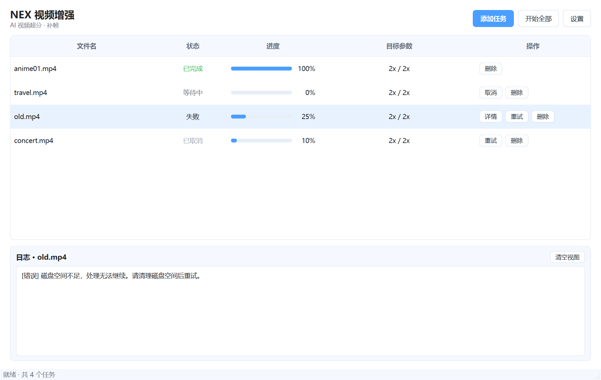
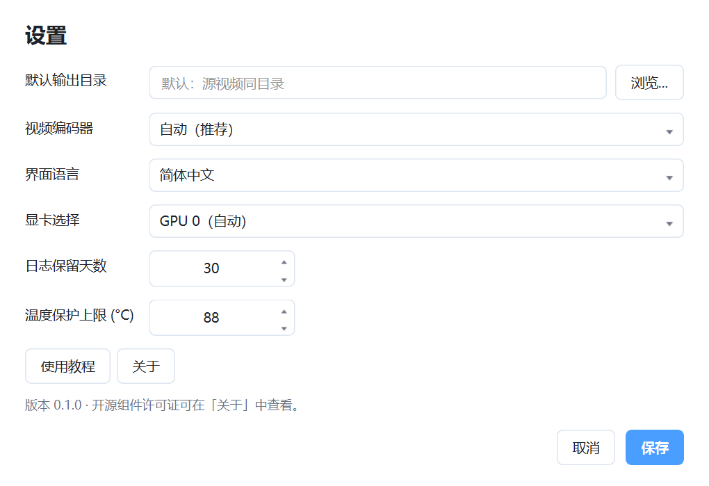
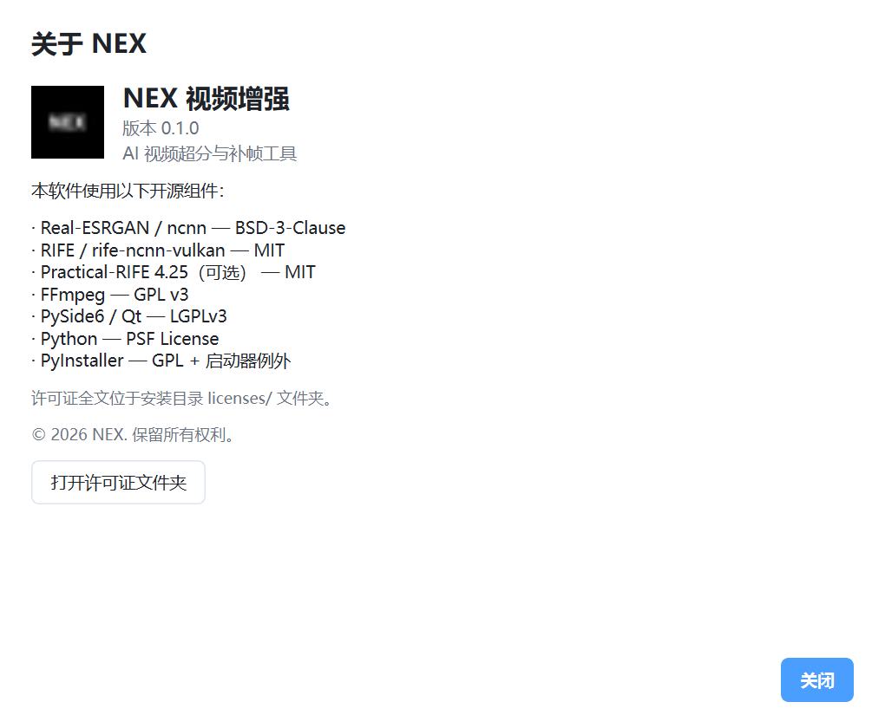
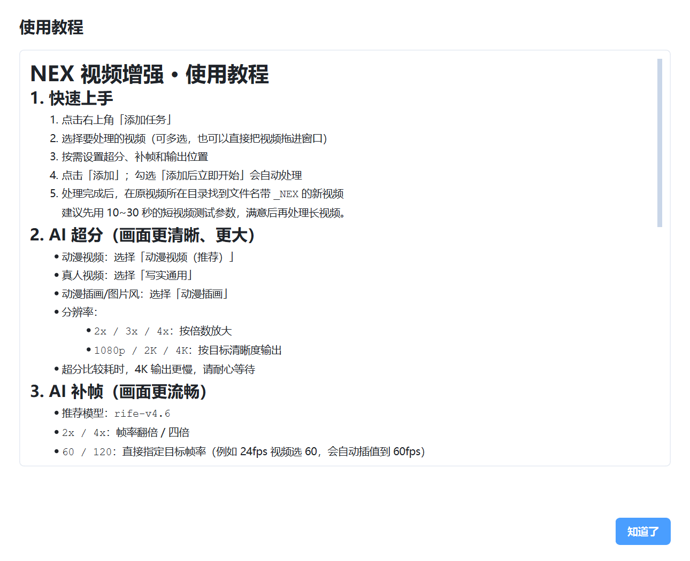

# 您的打赏可以帮助更新[](https://ifdian.net/a/pgy123)
# NEX 视频增强 · NEX Video Enhancer

Windows 11 桌面端 **AI 视频超分 + 补帧** 应用。导入视频，选择超分与补帧参数，导出保留原音频的新视频。

基于 **Real-ESRGAN**（超分）与 **RIFE**（补帧），通过 NVIDIA GPU（Vulkan）加速；主程序使用 Python + PySide6 构建，处理引擎以独立子进程运行。

> Open-source AI video super-resolution and frame interpolation app for Windows 11, built with PySide6, Real-ESRGAN and RIFE.



## 功能

- **AI 超分**：动漫 / 写实 / 动漫插画模型，支持 2x / 3x / 4x，或按 1080p / 2K / 4K 目标高度输出。
- **AI 补帧**：RIFE 模型（默认 rife-v4.6，另有 anime / HD / UHD），支持 2x / 4x 或 60 / 120fps。
- 超分与补帧可独立开启；两者可组合。
- **任务队列**：添加、开始、取消、重试、删除，进度实时显示，任务重启后恢复。
- **音频保留**：自动复制源音频；不兼容 MP4 的音频自动转 AAC。
- **中文 / English** 界面，白色 + 淡蓝色简洁风格。
- **安全与稳定性**：GPU 温度保护（默认 88°C）、开始前磁盘空间预检、超长中文路径支持、失败详情与日志。
- 每任务独立日志；引擎原始输出单独存档。

## 截图

| 主界面 | 设置 |
|---|---|
|  |  |

| 关于 | 使用教程 |
|---|---|
|  |  |

英文界面：[主界面](docs/assets/ui-s7-en.png) · [About](docs/assets/about-s7-en.png)

## 技术架构

```
PySide6 UI（原生控件 + QSS）
  └─ 任务队列（SQLite，%APPDATA%/NEX/nex.db）
       └─ QThread 单工作线程（GPU 独占）
            └─ 处理管线：抽帧 → Real-ESRGAN 超分 → RIFE 补帧 → FFmpeg 合成
                 └─ 外部引擎子进程（Vulkan / x264）
```

主要目录：

```
nex/                 # 主程序（UI、队列、管线、引擎封装、i18n）
tests/               # pytest 测试
build/               # PyInstaller 与 Inno Setup 脚本
docs/                # 需求、技术方案、界面规范、测试、发布与许可证
licenses/            # 第三方许可证文本与源码获取说明
devlog/              # 开发日志
engines/             # 第三方引擎与模型（不入库，需自行下载）
```

## 环境要求

- Windows 10 / 11（64 位）
- Python 3.11
- NVIDIA 显卡（RTX 30/40/50 系推荐；需支持 Vulkan）
- 足够的内存与临时磁盘空间（逐帧处理，长视频 / 4K 需要较多空间）

## 快速开始（开发环境）

1. 克隆仓库并创建虚拟环境：

   ```bat
   git clone https://github.com/Zy05w/NEX-Video-AI.git
   cd NEX-Video-AI
   py -3.11 -m venv .venv
   .venv\Scripts\python.exe -m pip install -r requirements.txt
   ```

2. 下载第三方引擎与模型，放到 `engines/`（目录结构见 [docs/07](docs/07-打包发布与授权合规.md)）：

   - FFmpeg（gyan.dev full build，需 `ffmpeg.exe` / `ffprobe.exe`）
   - `realesrgan-ncnn-vulkan` 及 `models/`
   - `rife-ncnn-vulkan` 及 `rife-v4.6` 等模型目录

   > 引擎与模型体积较大且遵循各自许可证，**不包含在本仓库中**。

3. 启动：

   ```bat
   .venv\Scripts\python.exe -m nex
   ```

4. 命令行处理（可选）：

   ```bat
   .venv\Scripts\python.exe -m nex.cli 输入.mp4 --sr realesr-animevideov3 --sr-scale 2
   .venv\Scripts\python.exe -m nex.cli 输入.mp4 --fi rife-v4.6 --fi-mult 2
   ```

## 测试

```bat
.venv\Scripts\python.exe -m pytest -q
```

当前 59 项测试通过（管线规划、队列/数据库、日志、i18n、磁盘预检、超长路径、友好错误、关于页等）。

## 打包

```bat
pyinstaller build/nex.spec
ISCC.exe build\installer.iss
```

产物在 `dist/NEX/` 与 `dist/installer/`。安装包为按用户安装（无需管理员），默认安装到 `%LOCALAPPDATA%\Programs\NEX`。

## 许可证与第三方组件

- **本项目代码**：MIT License，见 [LICENSE](LICENSE)。
- **第三方组件**：
  - Real-ESRGAN / ncnn：BSD-3-Clause
  - RIFE / rife-ncnn-vulkan：MIT
  - FFmpeg：GPL v3（以独立可执行文件调用；许可证全文与源码获取方式见 [licenses/](licenses/)）
  - PySide6 / Qt：LGPLv3（动态链接；见 [licenses/PySide6-NOTICE.txt](licenses/PySide6-NOTICE.txt)）
  - Python：PSF License
  - PyInstaller：GPL + 启动器例外
- Practical-RIFE 4.25（PyTorch）为可选高级引擎，代码与权重均为 MIT；默认不随标准安装包分发。
- 模型权重遵循各自上游许可证；分发时请保留对应许可证文本。

完整的商用合规说明见 [docs/07-打包发布与授权合规.md](docs/07-打包发布与授权合规.md)。

## 使用须知

- 请只处理你有权处理的视频，遵守当地法律与视频来源的许可条款。
- AI 超分 / 补帧属于正常 GPU 计算负载，但笔记本长时间处理时仍建议保持通风、电源接通。
- 非 16:9 视频按目标高度保持原比例输出（例如 4:3 → 1440×1080），不会强制拉伸。
- 本项目按现状提供，不附带任何明示或暗示担保；详见 MIT License。

## 参与贡献

欢迎提交 Issue 与 Pull Request。提交前请：

1. 运行 `pytest -q` 并确保全部通过；
2. 保持界面文案通过 `nex/i18n.py` 的 `t()` 输出，并同步英文；
3. 不提交 `engines/`、模型权重、虚拟环境、安装包或本地测试产物。

## 致谢

- [Real-ESRGAN](https://github.com/xinntao/Real-ESRGAN)
- [RIFE](https://github.com/hzwer/ECCV2022-RIFE) / [rife-ncnn-vulkan](https://github.com/nihui/rife-ncnn-vulkan)
- [FFmpeg](https://ffmpeg.org/)
- [PySide6 / Qt](https://www.qt.io/qt-for-python)
- 以及 `licenses/` 中列出的所有开源项目作者。
