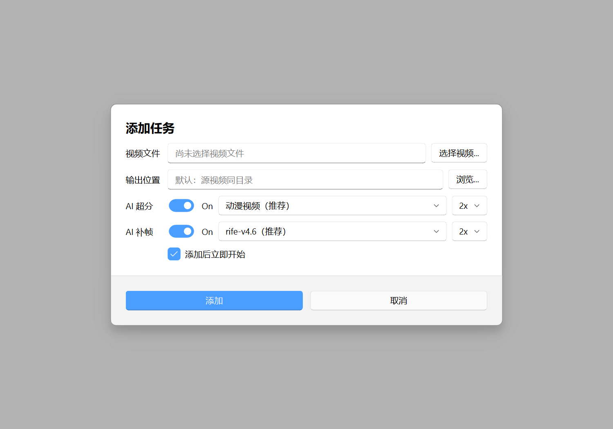
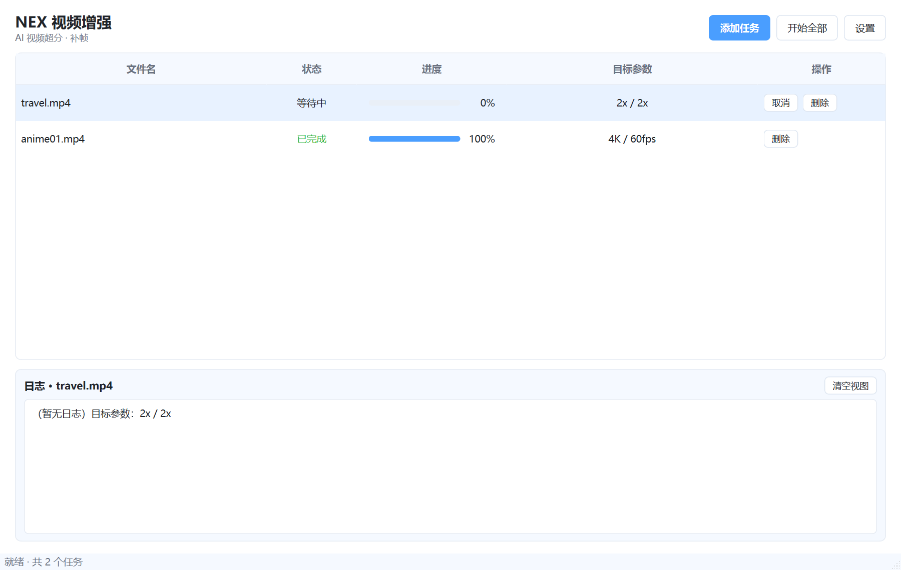
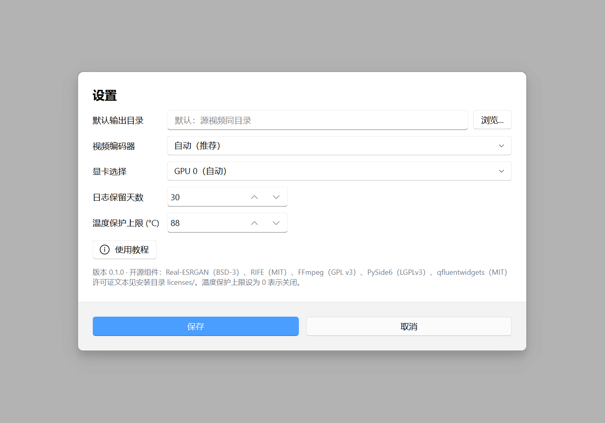
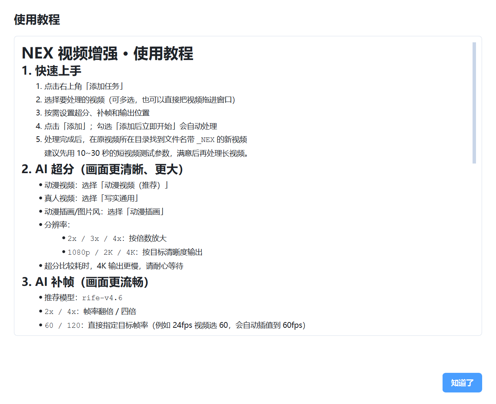
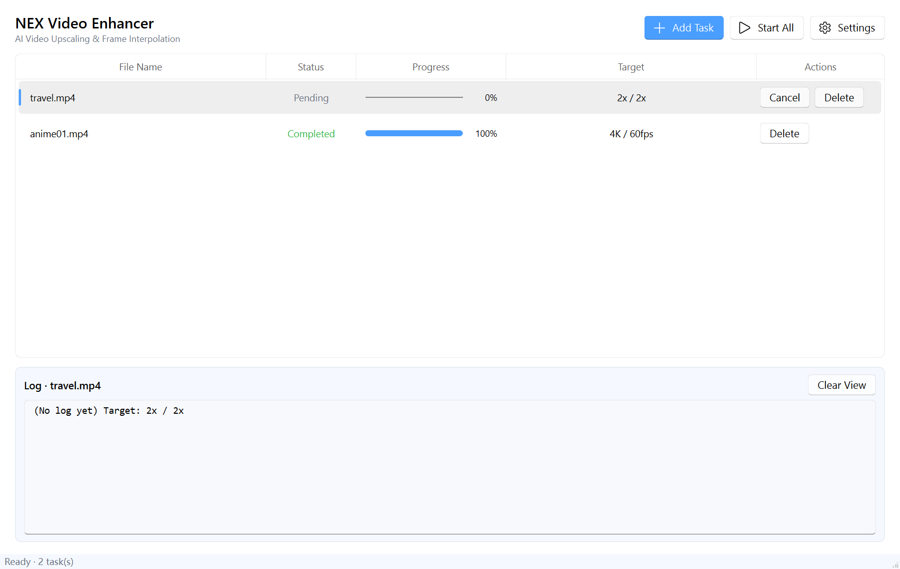
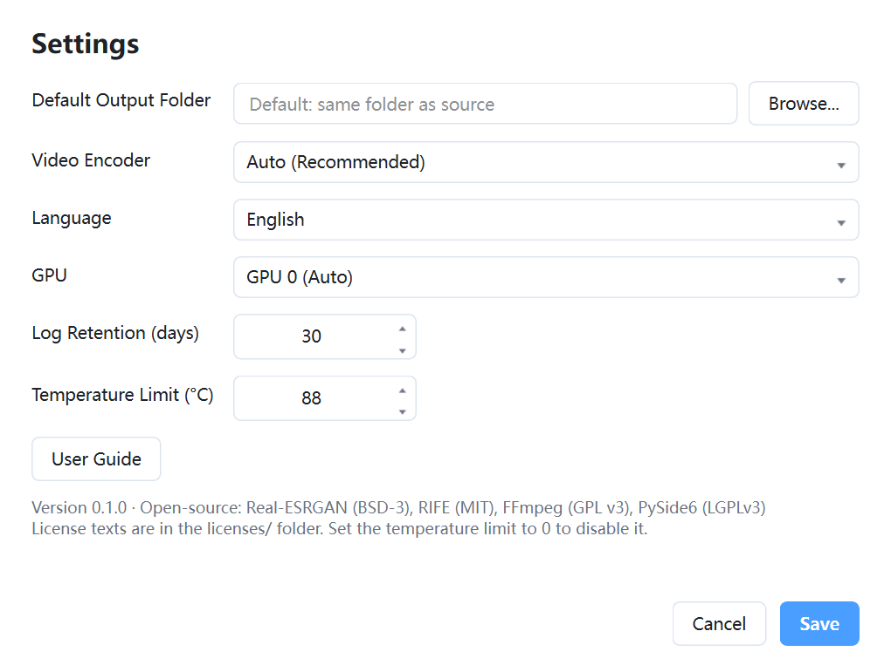
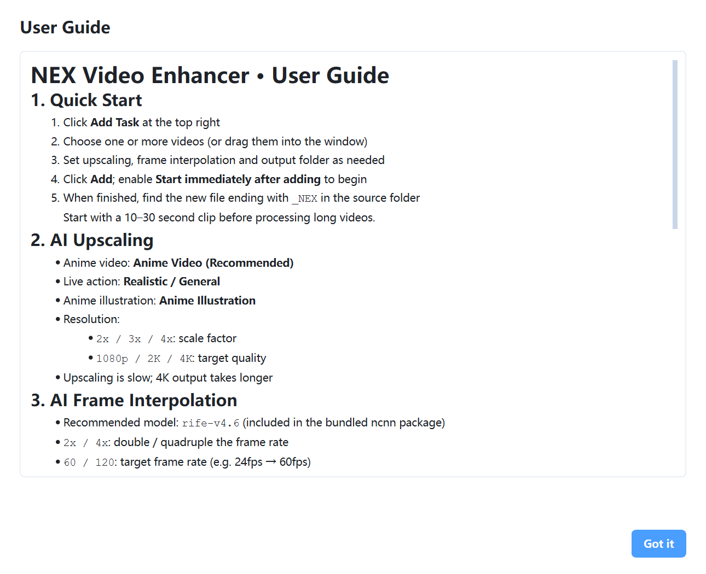

# 03 · 界面设计规范

> 版本：v1.0（2026-11-21）· 实施阶段：S2

## 1. 设计原则

- **简洁直观**：一屏完成主要操作；小白用户不看说明书也会用。
- **白 + 淡蓝**：大面积白色留白，淡蓝用于背景分区与强调；不使用深色主题（v1）。
- **反馈明确**：任何操作都有可见结果（进度、状态、提示），危险操作二次确认。

## 2. 色板

| 令牌 | 色值 | 用途 |
|---|---|---|
| `bg-primary` | `#FFFFFF` | 主窗口 / 卡片背景 |
| `bg-secondary` | `#F5F9FF` | 次背景、工具栏 |
| `bg-accent-soft` | `#E8F2FF` | 高亮区域、选中行背景 |
| `accent` | `#4A9EFF` | 主按钮、进度条、链接 |
| `accent-hover` | `#3A8EEF` | 悬停 / 按下 |
| `text-primary` | `#1F2329` | 正文、标题 |
| `text-secondary` | `#6B7280` | 辅助文字、时间戳 |
| `border` | `#E5EAF2` | 分割线、输入框边框 |
| `success` | `#2FB344` | 已完成 |
| `danger` | `#E5484D` | 失败、取消按钮文字 |
| `warning` | `#F5A623` | 提示 / 警告 |

## 3. 字体与排版

- 字体：`Microsoft YaHei UI`（微软雅黑 UI），缺省回退系统默认。
- 字号：窗口标题 20px / 区块标题 16px / 正文 14px / 辅助 12px。
- 行高 1.4；数字（进度、时长）可用等宽字体避免跳动。

## 4. 间距与形状

- 8px 栅格：4 / 8 / 12 / 16 / 24 / 32。
- 圆角：卡片 8px、按钮 6px、输入框 6px。
- 主窗口默认 1200×760，最小 960×600，可缩放。

## 5. 组件规范

- 统一使用 qfluentwidgets 控件（PrimaryPushButton、PushButton、LineEdit、ComboBox、SwitchButton、ProgressBar、TableWidget、TextEdit 等），不自定义绘制。
- 主按钮（添加任务 / 开始）用 `accent`；次按钮白底描边；取消 / 删除用文字按钮 + 悬停变 `danger`。
- 状态颜色：等待中灰、处理中蓝、已完成绿、失败红、已取消灰。
- 进度条高 8px，`accent` 色；表格行高 44px。

## 6. 主窗口布局

```
┌────────────────────────────────────────────────────────────────┐
│ NEX 视频增强        [＋添加任务] [▶开始全部] [⚙设置]             │
├────────────────────────────────────────────────────────────────┤
│ 文件名      状态     进度          目标参数      操作            │
│ 动漫01.mp4  处理中  ▓▓▓▓▓░░░ 45%  4K / 60fps  [取消][删除]      │
│ 旅拍.mp4    等待中  ——            2x / 60fps   [取消][删除]      │
│ 电影.mp4    已完成  100%          4K / 不补帧  ——    [删除]      │
│ 旧番.mp4    失败    25%           2x / 2x      [重试][删除]      │
├────────────────────────────────────────────────────────────────┤
│ 日志 · 动漫01.mp4                                    [清空视图]  │
│ 09:12:01 [抽帧] 完成，共 480 帧                                  │
│ 09:14:32 [超分] 120/480 帧（25%）                                │
└────────────────────────────────────────────────────────────────┘
```

- 顶部工具栏：标题 + 添加任务（主按钮）+ 开始全部 + 设置。
- 中部任务表格：选中行高亮 `bg-accent-soft`；表格下方留白。
- 底部日志面板：可折叠（默认展开 180px 高），显示选中任务日志，实时滚动到底部。

## 7. 添加任务对话框

- 视频文件：选择按钮（多选）+ 支持拖入窗口。
- 输出位置：默认源视频同目录，可改。
- 超分区：开关 + 模型下拉 + 分辨率下拉（原始 / 2x / 3x / 4x / 1080p / 2K / 4K / 自定义）。
- 补帧区：开关 + 模型下拉（rife-v4.6 默认；配置了 PyTorch 环境时额外显示 RIFE 4.25）+ 帧率下拉（2x / 4x / 60 / 120）。


- 底部："立即开始"复选框（默认勾选）、取消、确定。
- 参数非法时确定按钮禁用并就地提示原因。

## 8. 设置对话框

- 常规：默认输出目录、默认编码器（NVENC 推荐 / x264）、界面语言（简体中文 / English）、GPU 选择、日志保留天数、温度保护上限。
- 「使用教程」按钮：打开内置教程对话框（Markdown 排版、可滚动、只读，跟随界面语言）。
- 语言切换保存后提示重启生效；任务运行中提示任务结束后手动重启。
- 关于：版本号、开源组件与许可证列表（可展开）。

## 9. 交互与提示

- 删除任务记录：二次确认（"仅删除记录，不会删除视频文件"）。
- 处理中关闭软件：提示有任务正在处理，确认后终止。
- 错误提示用对话框 + 日志双通道；不把英文堆栈直接抛给用户。

## 10. 当前实现截图（S2-S5）







英文界面：







